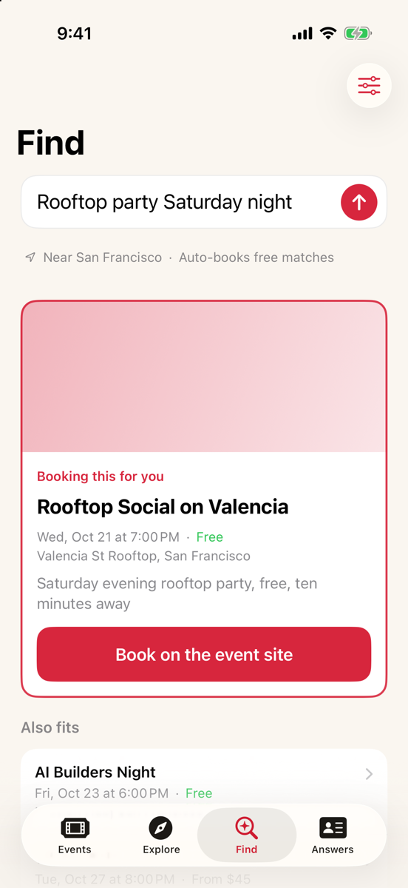
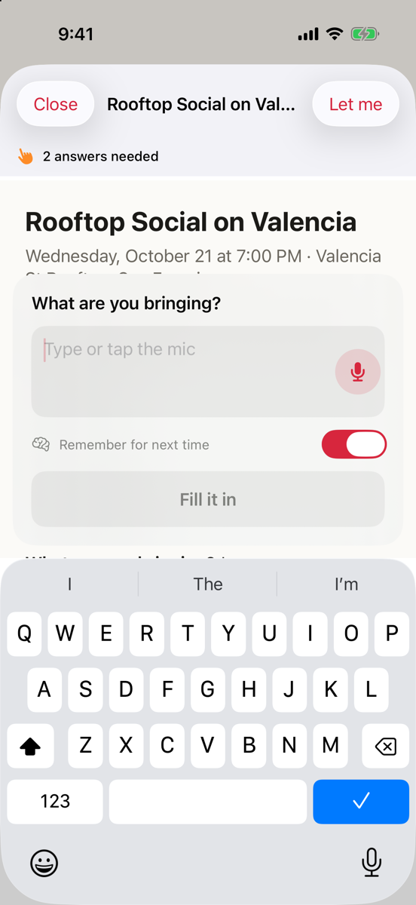
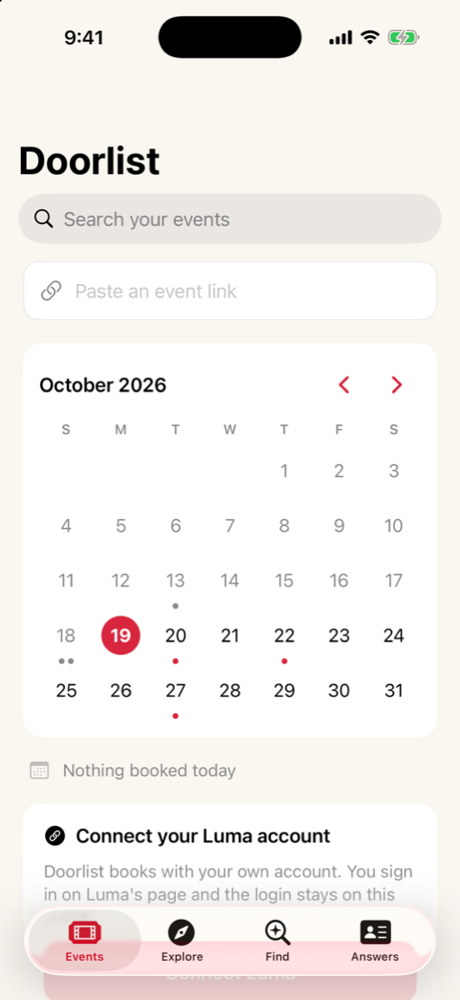
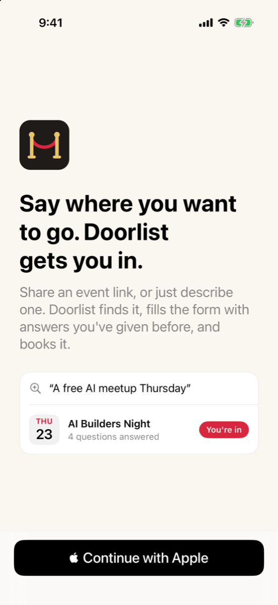
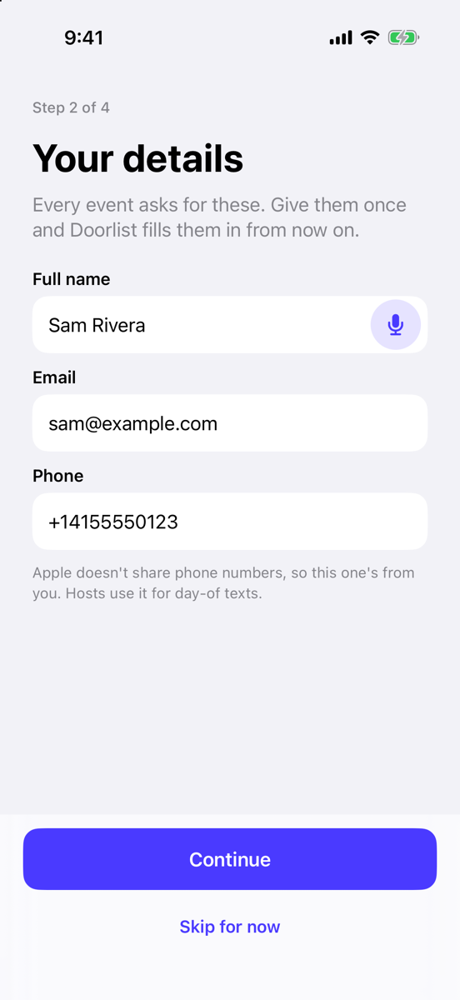
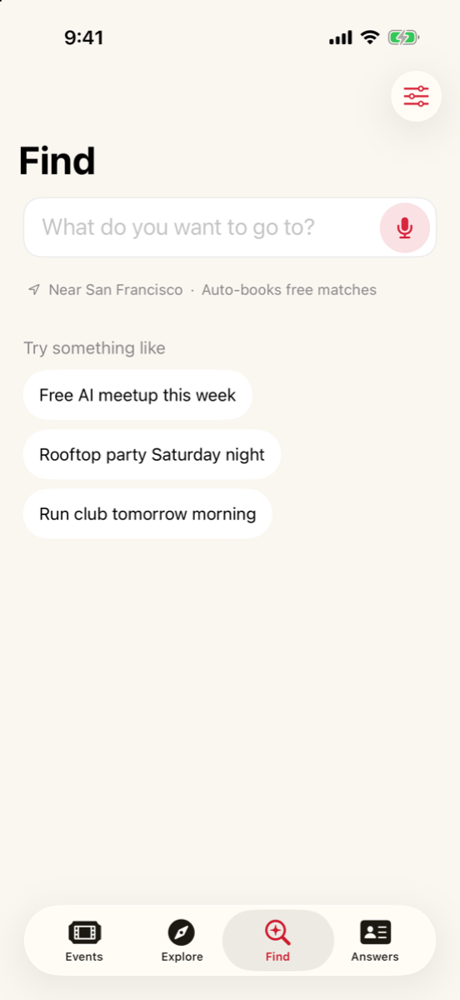
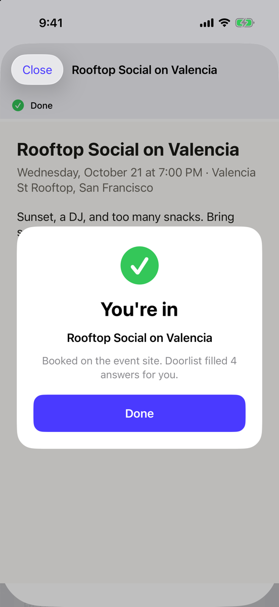
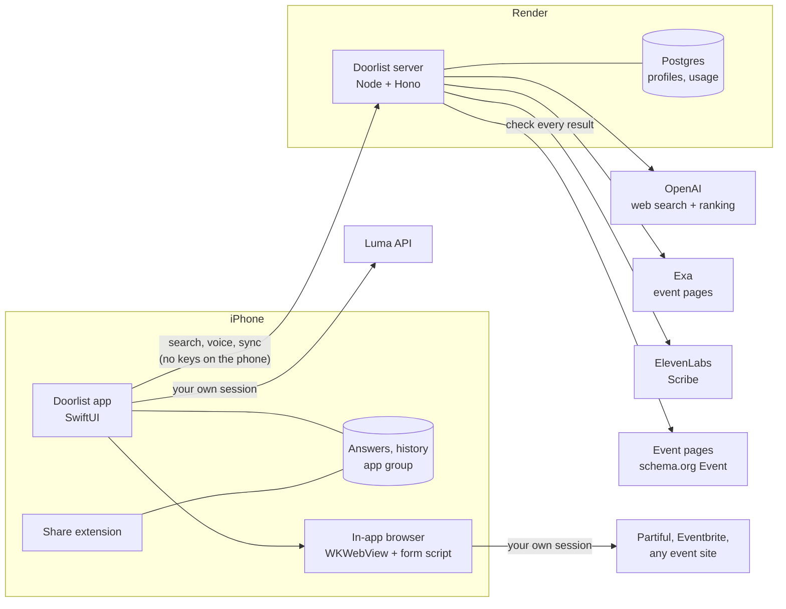

<div align="center">

&nbsp;&nbsp;
&nbsp;&nbsp;


# Doorlist

**Say where you want to go. Doorlist gets you in.**

An iPhone app that finds events anywhere on the web and registers you for them, filling every sign-up form with answers you've given before. Luma, Partiful, Eventbrite, Meetup, or any event page.

[Website](https://doorlist-site.onrender.com) · [Privacy](site/privacy.html) · [Terms](site/terms.html) · [Support](https://github.com/techadnank9/doorlist/issues)

</div>

---

## Why

Every event asks the same twelve questions in a slightly different order. *What's your role? Job title? Company? LinkedIn? How did you hear about us?* You answer them hundreds of times a year, on five different sites, often at 11pm when the RSVP just opened and spots are going.

Doorlist answers them once and remembers. Then it goes further: tell it what kind of night you want, and it finds the event, checks it's real, and books it.

## What it does

| | |
|---|---|
| **Find, by saying it** | "A free AI meetup Thursday." Doorlist searches the web near you (OpenAI web search plus Exa), opens every result to check the date, price and status, ranks what's left, and books the best free match. |
| **Book any link** | Paste or share a Luma, Partiful, Eventbrite or any event link. Luma books through its API in one request; everything else books on the event's own page inside Doorlist. |
| **Asked once, remembered** | "What's your role?", "Job title" and "What do you do?" are one answer. Matching runs on typed keys, wording rules, fuzzy matching, then Apple's on-device model. |
| **Answer by voice** | Every question has a mic. Speech goes to ElevenLabs Scribe through the server, with Apple's on-device recognition as the fallback. |
| **Asks you from anywhere** | If a booking needs an answer while you're in another app, a notification asks the question. Reply right in the notification. |
| **Your month** | A calendar with today picked, dots on booked days, and the day's events under it. |
| **Follows you** | Sign in with Apple and your answers and bookings sync to a new phone. |
| **Never pays** | Free events and free tiers only. Anything with a price stops and waits for you. |

## Screens

<table>
<tr>
<td width="25%"></td>
<td width="25%"></td>
<td width="25%"></td>
<td width="25%"></td>
</tr>
<tr>
<td><b>Welcome.</b> One decision: sign in with Apple, or carry on without an account.</td>
<td><b>Your details.</b> Name, email, phone. Apple never shares a phone number, and may hide your email, so this step fills the gaps.</td>
<td><b>Find.</b> One field, one button, a mic. Location and auto-booking are defaults, shown in one quiet line.</td>
<td><b>Booked.</b> A clear end state and a notification, wherever you are.</td>
</tr>
</table>

### Look and feel

The brand is a velvet rope: two brass posts and a red rope, the line you get past. Source art is in `design/logo/` (SVG, plus the 1024 px app icon).

| Token | Light | Dark | Use |
|---|---|---|---|
| Accent (velvet red) | `#D7263D` | `#EC3B52` | Everything you can tap, selected states, status |
| Canvas | `#FAF6F0` | `#12100E` | Screen background |
| Surface | `#FFFFFF` | `#1E1B18` | Cards, fields, list rows |
| Brass | `#C9A23F` | `#E9C46A` | The logo only; too low contrast for text |

The colours live in `Shared/Colors.xcassets` and are read through `Shared/Theme.swift`. White on the light accent is 4.96:1; the dark accent on the dark canvas is 4.8:1. Each screen keeps one input at the top. The send arrow appears only once the input holds something it can act on, so there are no greyed-out buttons.

### Functional views

| Screen | What you do there | What happens underneath |
|---|---|---|
| **Onboarding** (4 steps) | Sign in with Apple, confirm details, allow location, connect Luma. Every step after sign in can be skipped. | Apple's identity token is exchanged for a Doorlist session; existing account data syncs down before anything is typed. |
| **Events** | Paste a link; browse the calendar; search your bookings. | Links are classified (`EventLink`) and routed to the Luma or web booking engine. History comes from the local store, synced in the background. |
| **Find** | Describe an event, by text or voice. Answer one follow-up if asked. | Streams progress from `POST /v1/search`; marks calendar clashes and already-booked events on the phone; auto-books when the top result is checked, free, open and a strong fit. |
| **Booking (Luma)** | Answer any new question, one per screen. | `LumaClient` reads the event, `BookingPlanner` fills the form from memory, registration goes out in one request. |
| **Booking (web)** | Watch it fill; answer anything new in the bottom panel; tap **Let me** to take over. | An injected script reads the page's form (including same-site frames), fills known fields with native input events, taps RSVP / Register / Continue, stops on any price, and detects the confirmation. |
| **Answers** | See, edit and forget every saved answer; manage your account; delete it. | Forgetting writes a marker so other devices forget too. Delete account erases the server copy. |

## Architecture



### The search pipeline

```mermaid
sequenceDiagram
  participant P as Phone
  participant S as Server
  participant O as OpenAI
  participant E as Exa
  participant W as Event pages
  P->>S: request, town, past event names
  S-->>P: {"stage":"searching"}
  par
    S->>O: web_search with user_location
    S->>E: search on Luma, Partiful, Eventbrite, Meetup + open web
  end
  O-->>S: candidates (or one clarifying question)
  E-->>S: candidates
  S-->>P: {"stage":"checking","count":n}
  S->>W: open each page, read JSON-LD (date, price, status)
  Note over S: drop 404s, cancelled, past, listing pages
  S-->>P: {"stage":"ranking"}
  S->>O: strict JSON-schema ranking
  S-->>P: {"result":{"events":[...]}}
  Note over P: mark calendar clashes, already booked;<br/>auto-book if checked, free, open, match ≥ 0.75
```

### Details

**Booking engines.** Luma is booked through the same endpoints luma.com's web client uses, with the person's own session cookie kept in the Keychain. Every other site is booked on its own page: `App/WebBooking.swift` injects a script that scans inputs, selects, radio groups and checkboxes (including styled ones whose real input is hidden), maps each field to a remembered answer by autofill hint, input type, wording rules and fuzzy matching, sets values through the native setter so React forms notice, and ranks buttons (RSVP and Register first, Submit and Continue next, never anything naming a price, cookie banners or "can't go"). It never touches password, payment or one-time-code fields, and stops on a non-zero total or a payment iframe. Success is detected from confirmation text that wasn't on the page before Doorlist acted.

**Result checking.** `server/src/verify.ts` reads Luma through its public event endpoint and everything else through schema.org `Event` JSON-LD, which Partiful and Eventbrite both publish. A free tier among paid ones counts as free. Pages without a date are shown but never auto-booked.

**Sync.** `POST /v1/sync` merges the device's copy with the stored one: per answer the newest edit wins, deletions travel as markers, every booking is kept. Profiles are stored as JSONB in Postgres. Site logins never leave the phone.

**Cost meter.** Every upstream call records what it cost from the usage numbers the provider already returns: OpenAI tokens and web search calls, Exa's own `costDollars`, seconds of audio for ElevenLabs. No extra requests. `/admin` shows today, last 30 days, projected month, cost per search and per person, with a live feed pushed over Server-Sent Events, so watching it costs one idle connection.

**Abuse limits.** Daily caps per Apple account (or per install before sign in), body size limits, bounded inputs. App Attest is the next step before a public launch.

### Repository

```
App/                SwiftUI app: tabs, Find, web booking, onboarding, account
Shared/             Code shared with the share extension: Luma client, matcher, storage, sync, voice
ShareExtension/     Share sheet entry point
server/             Node + Hono API: search, verify, sync, transcribe, cost meter, admin
  test/             node:test suite, mock upstreams and practice event pages
site/               Landing page, privacy policy, terms, support
docs/screenshots/   Full-size screenshots from the simulator
render.yaml         Render setup: Postgres, server, static site
project.yml         XcodeGen project definition
```

## Run it

**Requirements:** Xcode 26, [XcodeGen](https://github.com/yonaskolb/XcodeGen), Node 22.13+, Docker (or any Postgres 15+).

```bash
# Server, against stand-ins for OpenAI, Exa and ElevenLabs (no keys needed)
docker run -d --name doorlist-pg -p 55432:5432 -e POSTGRES_PASSWORD=test -e POSTGRES_DB=doorlist postgres:17-alpine
cd server && npm install
npm run mock        # fake upstreams + practice event pages on :8790
npm run dev:mock    # the server on :8787, pointed at the mock
```

```bash
# App
xcodegen generate
open Doorlist.xcodeproj   # run the Doorlist scheme; Debug talks to localhost:8787
```

With real keys, copy `server/.env.example` to `server/.env`, fill it in, and run `npm run dev`.

## Test it

```bash
cd server && npm test
```

17 tests cover link classification, page checks against real-shaped Partiful and Eventbrite markup, input bounds, sessions, cost maths, the full streamed search (dead links dropped, Exa duplicates merged, ranking), clarifying questions, rate limits, transcription, two-device sync with deletions, account deletion, and the admin dashboard.

The app was run end to end in the simulator against the mock: onboarding, Find with location, auto-booking a Partiful-style RSVP with a new question and a consent box, an Eventbrite-style registration with a ticket count and dropdown (no questions asked), stopping on a paid event, the calendar, and restoring a profile on a fresh install.

## Deploy

`render.yaml` sets up a Postgres database, the server and the static site. In Render: **New → Blueprint →** this repo. Then add `OPENAI_API_KEY`, `EXA_API_KEY` and `ELEVENLABS_API_KEY` under the server's Environment. `SESSION_SECRET` and `ADMIN_TOKEN` are generated; open `/admin?token=<ADMIN_TOKEN>` for costs. Set `DOORLIST_API_BASE` for Release in `project.yml` to the server URL.

## Privacy

Site logins, precise location and your calendar stay on the phone. Search sends your request, your town and the names of past events. Voice recordings are transcribed and not kept. Signed-in profiles are stored with your account and erased when you delete it. Full policy: [site/privacy.html](site/privacy.html).

## Status and limits

- Booking on Partiful and Eventbrite relies on their pages; a redesign can need a script update.
- Luma booking uses Luma's private web endpoints and can break if they change.
- Sign in with Apple needs a signed build with the capability enabled.
- Not affiliated with Luma, Partiful, Eventbrite or Meetup.

## License

MIT
